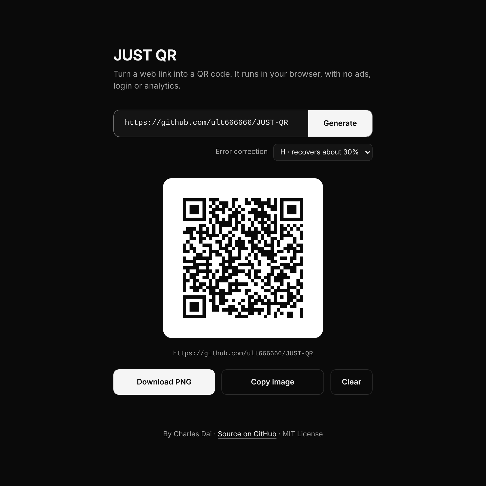

# JUST QR

A minimal QR code generator that runs entirely in your browser. No ads, no login, no analytics.

**[Open JUST QR](https://ult666666.github.io/JUST-QR/)**



## Features

- **Paste and go.** Type or paste a URL and press Enter or **Generate**. A missing `https://` is added for you.
- **Recoverable errors.** Invalid URLs and URLs too large for a QR code show a persistent message beside the input. Correct the URL and generate again; failed attempts clear the old code so it cannot be exported by mistake.
- **Error correction you choose.** Level H is the default, so codes still scan with roughly 30% of the symbol damaged or covered. L, M and Q make smaller codes and fit longer URLs.
- **Download PNG.** Exports the code with a white quiet zone around it, named after the URL, for example `qr_github_com_ult666666_JUST_QR.png`.
- **Copy to clipboard.** Copies the same padded PNG as the download, ready to paste into a document or chat. Both have a 40-pixel white quiet zone and are 320×320 pixels for typical URLs; very long URLs get a larger image so that every module stays at least 2 pixels wide. If the browser blocks image copying, it suggests downloading instead.
- **Private by design.** There is no backend: the URL you enter never leaves your browser. The QR encoder is this repository's own code, served with the page, and a Content Security Policy only allows scripts from the page's origin. The only third-party request is for two Google Fonts.

## Run it locally

It's a static folder with no build step. Serve it (browsers do not load JavaScript modules from `file://` pages):

```bash
python3 -m http.server 8000
# then visit http://localhost:8000
```

## How it works

[`index.html`](index.html) holds the markup, [`style.css`](style.css) the styles, [`app.js`](app.js) the page logic and [`qr.js`](qr.js) the QR encoder. No build step or production package installation is required.

- **Encoding:** [`qr.js`](qr.js) is a dependency-free ES module that follows ISO/IEC 18004:2015 (QR Code Model 2): versions 1 to 40; error correction levels L, M, Q and H; numeric, alphanumeric and byte (UTF-8) modes; Reed-Solomon error correction over GF(256) with block interleaving; BCH-coded format and version information; and all eight data masks, chosen by the standard's four penalty rules. It picks the smallest version that holds the data. Its structure follows the standard's sections and two public walkthroughs, [Thonky's QR Code Tutorial](https://www.thonky.com/qr-code-tutorial/) and [Nayuki's step-by-step guide](https://www.nayuki.io/page/creating-a-qr-code-step-by-step). A URL is a single byte-mode segment; the encoder does not mix modes within one code or add an ECI header, and has no Kanji, Micro QR or structured-append support.
- **Rendering:** modules are drawn on a canvas as whole-pixel squares (at least 2 pixels each) centred in 240 pixels, so exports stay sharp.
- **Content Security Policy:** `script-src 'self'`, styles from the page and Google Fonts, fonts from Google Fonts, and nothing else. There are no inline scripts, styles or event handlers.
- **URL validation:** the browser's URL parser accepts HTTP and HTTPS links, including localhost/IP addresses and ports. Other schemes, internal whitespace, backslashes and embedded credentials are rejected. The displayed and encoded URL uses the browser's canonical escaping, so Unicode paths work too. No URL is fetched or checked for availability.
- **Download:** redraws the code onto a padded canvas and saves it as a PNG. A URL too long for the chosen level is reported with a suggestion to shorten it or lower the level.
- **Copy:** uses the asynchronous Clipboard API with a PNG `ClipboardItem`.

## Try the recovery workflow

1. Serve the folder as above and open `http://localhost:8000`.
2. Generate `example.com/docs`. The preview shows the normalized HTTPS URL.
3. Try `not a URL` or `ftp://example.com/file`. An inline error appears and the previous code is cleared.
4. Try a valid but oversized URL, for example `https://example.com/?q=` followed by 2,000 `a` characters. The page asks you to shorten it.
5. Generate `https://example.com/recovered`. The error disappears. Download the PNG or copy it; both include the same white border.

Image copying requires a browser that supports the Clipboard API and grants permission, normally on HTTPS or localhost. Download remains available when copying is blocked. QR capacity depends on the encoded URL; long links make denser symbols, so scan-test your exported code before printing.

## Tests

With Node.js 20 or newer and Python 3 installed:

```sh
npm ci
npx playwright install chromium --only-shell
npm test
```

`npm test` runs 27 Playwright tests in three files:

- [`tests/encoder.spec.mjs`](tests/encoder.spec.mjs) (Node, no browser) checks the encoder against published examples: the ISO/IEC 18004 Annex I Reed-Solomon example and the format, version, mask-penalty and full-symbol ("ABCDEF" at level H) vectors from [zxing's encoder tests](https://github.com/zxing/zxing/tree/master/core/src/test/java/com/google/zxing/qrcode/encoder). It compares the error correction block table, alignment positions and byte capacities with qrcodejs's copies; fills version 40 to its published maximum in every mode and level; decodes random numeric, alphanumeric, ASCII and Unicode texts across 30+ versions, all levels and forced masks with [jsQR](https://github.com/cozmo/jsQR); and checks that the chosen mask has the lowest penalty.
- [`tests/differential.spec.mjs`](tests/differential.spec.mjs) runs [qrcodejs](https://github.com/davidshimjs/qrcodejs) 1.0.0, the library the page used to load (now only a development dependency), in Chromium on 123 random ASCII texts of up to each level's capacity. qrcodejs refuses 3 of them (see below); for the other 120, spanning 38 versions, every symbol matches qr.js module for module once both use qrcodejs's mask and version. They can legitimately differ in two ways: qrcodejs scores masks with its own rules rather than the standard's (it picked a different mask in 83 of 120 cases, and qr.js's choice never scored worse under the standard's rules), and it adds 3 bytes to every length because its UTF-8 helper compares a number with a string, so it sometimes uses one version more (8 cases).
- [`tests/qr.spec.mjs`](tests/qr.spec.mjs) drives the page in Chromium: generation, invalid and oversized input recovery, Enter/Clear, Unicode URLs, the error-correction selector, an unavailable encoder, clipboard failure, and a check that no third-party script loads and the CSP reports no violations. It decodes downloaded and copied PNGs with jsQR and checks every pixel of their white quiet zones. Only the operating-system clipboard boundary is replaced.

The tests found two errors in the libraries they use as references, both recorded as tests. qrcodejs's block table for version 15-H lists 11 blocks instead of 18, so it refuses URLs of about 195 to 220 bytes at level H with "code length overflow"; the old page reported them as too long, and qr.js encodes them. jsQR 1.4.0's table puts version 23's fourth alignment pattern at 74 instead of 78 (Annex E), so it cannot read version 23 symbols at level L, where error correction cannot absorb the misread modules.

The read-only [QR checks workflow](.github/workflows/qr.yml) runs these tests for pull requests targeting `main`, pushes to `main`, and manual runs, using Node.js 24 and Python 3.13. It installs the pinned test dependencies without package install scripts, then runs headless Chromium; it has no deployment steps. Set `QR_TEST_PORT` to run the local test server on a port other than 8096.

## License

[MIT](LICENSE)
