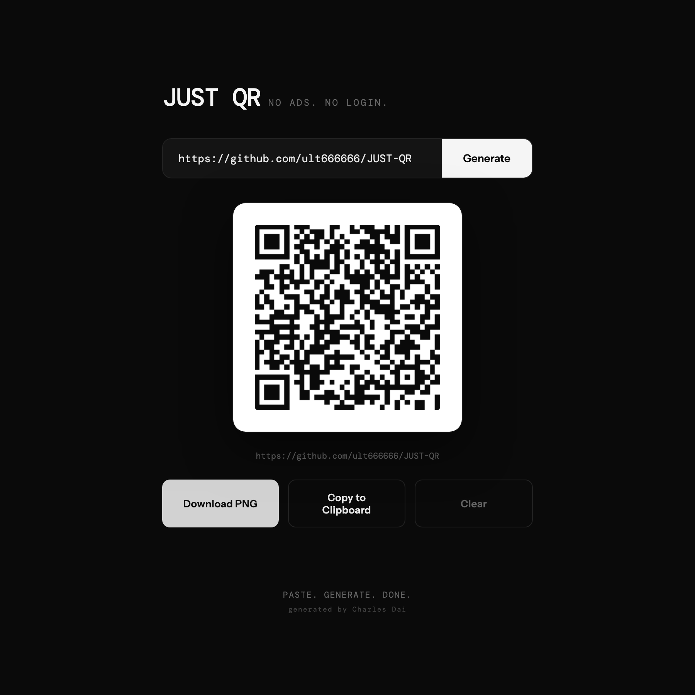

# JUST QR

A minimal QR code generator that runs entirely in your browser. No ads, no login, no analytics.

**[Open JUST QR](https://ult666666.github.io/JUST-QR/)**



## Features

- **Paste and go.** Type or paste a URL and press Enter or **Generate**. A missing `https://` is added for you.
- **Recoverable errors.** Invalid URLs and URLs too large for the QR library show a persistent message beside the input. Correct the URL and generate again; failed attempts clear the old code so it cannot be exported by mistake.
- **Scans reliably.** Codes use error-correction level H, so they still scan with roughly 30% of the symbol damaged or covered.
- **Download PNG.** Exports the code with a white quiet zone around it, named after the URL, for example `qr_github_com_ult666666_JUST_QR.png`.
- **Copy to clipboard.** Copies the same padded PNG as the download, ready to paste into a document or chat. Both are 320×320 pixels with a 40-pixel white quiet zone. If the browser blocks image copying, it suggests downloading instead.
- **Private by design.** There is no backend: the URL you enter never leaves your browser. The page loads two things from public CDNs: the QR library (from cdnjs, pinned with a Subresource Integrity hash) and two Google Fonts.

## Run it locally

It's a single static file. Open `index.html` in a browser, or serve the folder:

```bash
python3 -m http.server 8000
# then visit http://localhost:8000
```

## How it works

[`index.html`](index.html) holds all production markup, styles and JavaScript. No build step or production package installation is required.

- **Rendering:** codes come from [qrcodejs](https://github.com/davidshimjs/qrcodejs) 1.0.0, loaded from cdnjs with a Subresource Integrity hash, so the browser refuses a tampered copy.
- **URL validation:** the browser's URL parser accepts HTTP and HTTPS links, including localhost/IP addresses and ports. Other schemes, internal whitespace, backslashes and embedded credentials are rejected. The displayed and encoded URL uses the browser's canonical escaping, so Unicode paths work too. No URL is fetched or checked for availability.
- **Download:** redraws the code onto a padded canvas and saves it as a PNG. QR capacity failures are caught even when the library throws a generic error.
- **Copy:** uses the asynchronous Clipboard API with a PNG `ClipboardItem`.

## Try the recovery workflow

1. Serve the folder as above and open `http://localhost:8000`.
2. Generate `example.com/docs`. The preview shows the normalized HTTPS URL.
3. Try `not a URL` or `ftp://example.com/file`. An inline error appears and the previous code is cleared.
4. Try a valid but oversized URL, for example `https://example.com/?q=` followed by 2,000 `a` characters. The page asks you to shorten it.
5. Generate `https://example.com/recovered`. The error disappears. Download the PNG or copy it; both include the same white border.

Image copying requires a browser that supports the Clipboard API and grants permission, normally on HTTPS or localhost. Download remains available when copying is blocked. QR capacity depends on the encoded URL; long links make denser symbols, so scan-test your exported code before printing.

## Browser tests

With Node.js 20 or newer and Python 3 installed:

```sh
npm ci
npx playwright install chromium --only-shell
npm test
```

[`tests/qr.spec.mjs`](tests/qr.spec.mjs) serves the exact SRI-pinned QR library locally, so the tests need no external network after installation. Chromium exercises real generation, invalid/oversized-input recovery, Enter/Clear, Unicode URLs, unavailable-library feedback and clipboard failure. The suite independently decodes downloaded and copied PNGs and checks every pixel in their white quiet zones. Only the operating-system clipboard boundary is replaced; the QR renderer, canvas, PNG blobs and decoder are real. Development dependencies do not change the static page's deployment.

The read-only [QR browser checks workflow](.github/workflows/qr.yml) runs these nine scenarios for pull requests targeting `main`, pushes to `main`, and manual runs, using Node.js 24 and Python 3.13. It installs the pinned test dependencies without package install scripts, then runs headless Chromium; it has no deployment steps.

## License

[MIT](LICENSE)
